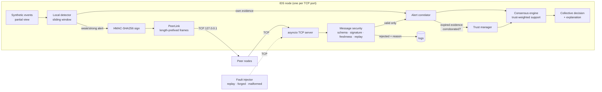

# Collaborative Intrusion Detection Between Socket Nodes

An academic simulation of a **decentralised Collaborative Intrusion Detection System (CIDS)**.
Several independent IDS nodes each watch their own slice of (synthetic) network traffic, detect
suspicious activity locally, and share **signed alerts over real TCP sockets**. Each node validates
what it receives, correlates evidence from different peers, keeps a **trust score** for every peer,
and makes a **trust-weighted collective decision** about whether an intrusion is happening.

> Defensive, isolated lab simulation. All traffic is synthetic and every socket is on `127.0.0.1`.
> Nothing scans or contacts a real network.

## Quick start (Windows PowerShell)

```powershell
cd NP_AAT_FINAL
py -3.11 -m venv .venv          # Python 3.11 or newer
.\.venv\Scripts\Activate.ps1    # if blocked: Set-ExecutionPolicy -Scope Process Bypass
pip install -r requirements.txt

python -m pytest                # run the automated tests
python run_sim.py               # one demo run in the terminal (no dashboard)
streamlit run app.py            # launch the dashboard (opens http://localhost:8501)
```

More command-line examples:

```powershell
python run_sim.py --config configs/misleading_peer.json
python run_sim.py --nodes 6 --malicious N4 --replay --invalid --duplicates 3
python run_sim.py --offline N3 --delay 2 --drop 0.2 -v      # -v prints socket/validation logs
python run_sim.py --experiments all --seeds 5               # full experiment plan -> CSV files
python run_sim.py --experiments 5_misleading_peer 6_peer_failure --seeds 10
```

Each single run exports CSV tables and a JSON log to `results/run_<timestamp>/`.

## Architecture



Message flow for one simulated second (one *round*):

1. Each online node feeds its own events to its local detector.
2. The detector produces detections; the node signs alerts and frames them.
3. Frames are written to each peer over persistent TCP connections (with optional delay, loss, duplication).
4. The receiving server reads complete frames, then validates schema → sender → HMAC → content → freshness → replay.
   Only valid alerts reach the correlator.
5. At the end of the round each node expires old evidence (updating trust), then decides on every active target.

## Modules

| File | Purpose |
|---|---|
| `cids/config.py` | All settings (`SimConfig`), node ids, validation with clear error messages |
| `cids/models.py` | `Event`, `Incident` (ground truth), `Alert` (wire message), `EvidenceRecord`, `Decision` |
| `cids/event_generator.py` | Reproducible synthetic events for every scenario, with partial visibility per node |
| `cids/local_detector.py` | Sliding-window threshold detector with score, decision and explanation |
| `cids/socket_transport.py` | 4-byte length framing, size limit, partial reads, `PeerLink` with timeout + back-off reconnect |
| `cids/message_security.py` | HMAC-SHA256 signing, schema/sender/content checks, freshness, replay and duplicate detection |
| `cids/alert_correlator.py` | Groups evidence by `(target_id, event_type)`, one record per sender, window expiry, corroboration |
| `cids/trust_manager.py` | Bounded [0, 1] trust with logged reasons |
| `cids/consensus_engine.py` | Trust-weighted quorum decision with explanation |
| `cids/baselines.py` | Local-only and ordinary majority-voting rules |
| `cids/node.py` | One IDS node: TCP server, sending, validation, correlation, trust, decisions |
| `cids/fault_injector.py` | Lab attacker: replays captured frames, sends forged/malformed/oversized/truncated frames |
| `cids/simulation.py` | Orchestration: starts nodes, runs rounds, synchronises delivery, collects results |
| `cids/metrics.py` | TP/FP/TN/FN, precision, recall, F1, FPR, latency (zero denominators → `n/a`) |
| `cids/experiments.py` | Named experiments over many seeds, mean and standard deviation |
| `cids/reporting.py` | Result tables and CSV/JSON export |
| `run_sim.py` | Command-line interface |
| `app.py` | Streamlit dashboard |
| `tests/` | Unit, protocol, network, end-to-end and settings tests |

## Alert protocol

Each frame is a 4-byte big-endian length followed by a UTF-8 JSON body (max `max_frame_bytes`, default 8192).

```json
{"alert_id":"N2-000014","event_id":"E000233","sender_id":"N2","timestamp":19,
 "event_type":"port_scan","target_id":"10.0.1.2","severity":"medium","confidence":0.625,
 "evidence_summary":"5 port_scan events on 10.0.1.2 in last 10s (weak>=2, strong>=8)",
 "protocol_version":"1.0","signature":"<HMAC-SHA256 hex>"}
```

The signature covers every other field (sorted-key canonical JSON). No raw events are sent.
Rejection reasons: `invalid_json`, `oversized`, `truncated_frame`, `malformed`, `schema`, `bad_version`,
`unknown_sender`, `bad_signature`, `invalid_content`, `stale`, `future_timestamp`, `duplicate`, `replay`.

## Detection and decision logic

**Local detector.** For each `(target, event_type)` it counts suspicious events in the last
`detection_window` seconds. `confidence = min(1, count / strong_threshold)`.
At `weak_threshold` events the node sends a weak alert to peers; at `strong_threshold` it is a strong local detection.

**Correlation.** Evidence is grouped by `(target_id, event_type)`. Only the latest record per sender is kept,
so repeated messages from one node never count as extra corroboration. Evidence older than
`correlation_window` seconds expires.

**Trust.** Every peer starts at `initial_trust`. When a peer's evidence expires:
`+trust_reward` if another independent node reported the same target while it was active, otherwise
`−trust_penalty`. An authenticated message with impossible content or a future timestamp costs
`−invalid_penalty`. Duplicates, replays and stale copies do **not** penalise the signer, because an attacker or
the network can create them (otherwise an attacker could frame an honest node). Trust is never updated from
the collective decision itself, and hidden ground truth is never used.

**Collective decision (trust-aware CIDS).**

```
support = Σ trust(sender) × confidence     over distinct senders with trust ≥ min_trust_to_count
INTRUSION  if  (support ≥ quorum_threshold  and  sources ≥ min_sources)
           or  this node's own detector is strong (local override)
```

The node trusts itself with weight 1.0. Severity is informational only. If too few peers are reachable, the
explanation says "reduced confidence" rather than inventing corroboration.

This is a weighted evidence aggregation rule, **not** a Byzantine consensus protocol.

## Baselines and evaluation

All three approaches are computed in the same run from the same events and the same validated messages:

* **A. Local-only IDS** — flag only on the node's own strong detection.
* **B. Ordinary majority voting** — flag if more than half of all configured nodes currently report the target (no trust).
* **C. Trust-aware CIDS** — the rule above.

**Unit of evaluation:** every `(target_id, event_type)` that appeared in any suspicious event or any alert.
It is an attack if it belongs to an injected attack incident, otherwise benign. An approach flags a unit if
**any honest, online node** flags it at any time (misleading nodes' own verdicts are excluded).
This turns per-node decisions into one system-level decision per unit so all approaches are compared the same way.
Latency = first flag time − incident start time (simulated seconds).

## Scenarios (event mix)

| Scenario | What happens | Who should catch it |
|---|---|---|
| Concentrated | One node sees a high-rate `syn_flood` | Every approach (local override) |
| Distributed | 3 nodes each see part of a `port_scan`, each below the strong threshold | Collaboration needed |
| Low-rate | Every node sees just above the weak threshold of `brute_force` | Only the combined evidence |
| Benign look-alike | Two nodes see a small burst from an internal host | Should **not** be flagged |
| Background | Normal traffic plus rare isolated suspicious-looking events | Should not be flagged |

Faults and attacks (any combination): offline nodes (from a chosen second), misleading nodes (hide real findings,
send fabricated but correctly signed alerts), duplicate flooding, replay attacker, invalid/malformed frames,
extra network delay, message loss.

## Experiments

`python run_sim.py --experiments all --seeds 5` (or the dashboard's Experiments tab) runs:

1. benign only · 2. localised high-rate · 3. distributed · 4. low-rate distributed · 5. misleading peer ·
6. peer failure · 7. duplicate + replay + invalid frames · 8. node scaling (3, 4, 6, 8) ·
9. network delay (0–6 s) · 10. reduced availability (0–40 % loss)

Each row records configuration (JSON), seed, confusion counts, metrics, communication cost, CPU time and timestamp.
Two CSV files are written: raw per-seed rows and a mean/std summary. Results come straight from the runs and are not
tuned afterwards. In our runs the trust-aware rule did not always win: with a misleading peer, majority voting
had slightly higher recall on average, and with long delays every collaborative rule degrades because alerts
arrive stale. Report what your runs show.

## Dashboard

Sidebar: every `SimConfig` setting (nodes, seed, duration, event mix, detector thresholds, correlation window,
quorum, minimum sources, trust parameters, message age, frame size, and all fault switches).
Press **Run simulation**; nodes start on free localhost ports and are always shut down at the end, so reruns never
clash over ports. Tabs: Overview (topology + incidents), Alert feed, Decisions (with explanations and the
correlation log), Trust (history and matrix), Security (rejections, attacker traffic, links), Baseline comparison,
Experiments (multi-seed with error bars) and Export (CSV and JSON).

## Tests

`python -m pytest` covers framing under partial reads, oversized/truncated/invalid frames, valid and forged
signatures, schema and sender checks, freshness boundaries, duplicate and replay detection, detector windows,
correlation-window boundaries, distinct-source counting, corroboration, trust bounds, quorum at the threshold
boundary, low-trust exclusion, majority rule, metrics against hand-computed values, disconnect and reconnect,
shutdown and port cleanup, end-to-end distributed detection, offline and misleading peers, attack traffic being
rejected without changing decisions, reproducibility, and **every setting** being changed individually and all at once.

## Limitations

* Synthetic events with simple patterns; real traffic is far noisier.
* Rule-based detection and heuristic trust; thresholds are hand-chosen.
* Node identities and lab HMAC keys are configured in code (derived from a fixed lab value). A real system needs
  key distribution, rotation and per-pair or certificate-based authentication. TLS is not enabled.
* All nodes run in one process on localhost; real network effects are approximated by delay/loss settings.
* Time advances in discrete one-second rounds, and delivery is synchronised each round.
* The decision rule is not Byzantine fault tolerant: colluding misleading nodes, or a node that behaves well to
  build trust and then lies, can still mislead it.
* A misleading node that only *suppresses* its findings is not penalised (silence is indistinguishable from no traffic).
* Resource figures are environment-dependent.

## Possible future work

TLS with a local lab CA, per-pair keys, gossip-based alert forwarding, trust decay over time, adaptive
thresholds, evaluation on a public IDS dataset replayed as events, and running nodes as separate processes or containers.

## Troubleshooting

* **`Activate.ps1 cannot be loaded`** — run `Set-ExecutionPolicy -Scope Process Bypass`, then activate again.
* **`No module named cids`** — run commands from the project folder (the one containing `app.py`).
* **Firewall prompt** — allow Python on private networks; all traffic is to `127.0.0.1`.
* **Dashboard shows an error about settings** — the message says which value is invalid (for example
  weak threshold must be below strong threshold, or every node is marked offline).
